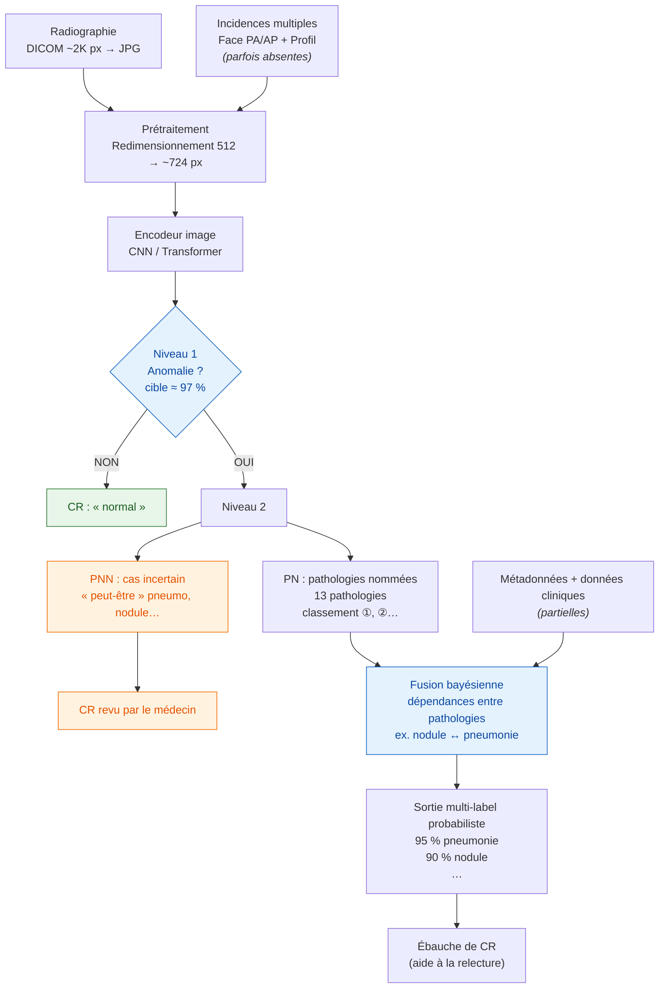

# Cas technique — IA appliquée à la radiographie thoracique

Test technique pour un poste de **Data Scientist / ML Engineer**.

Une startup veut détecter des anomalies sur des radiographies du thorax et pré-remplir un compte rendu que le radiologue relit. Vous partez de radiographies et de comptes rendus en texte libre, **sans labels**. La vérité terrain est à extraire des comptes rendus, puis vous construisez un système hiérarchique :

- **Niveau 1** : normal / anormal, qui doit être le plus fiable des deux niveaux ;
- **Niveau 2** : 13 pathologies en multi-label probabiliste et calibré ;
- gestion de **vues multiples** et de **données cliniques partielles** ;
- **fusion bayésienne** des sorties image, des dépendances entre pathologies et de la clinique.

### Architecture envisagée par le client



L'énoncé complet est dans **`usecase_radiologie_candidat.ipynb`**.

> **Ce qui est évalué :** la rigueur et la justification de votre démarche, bien plus que le score final.

---

## ⏱️ Durée

- **Délai de rendu : 10 jours** à partir de la réception du lien.
- **Temps de travail indicatif : 2 à 3 jours effectifs.** Vous n'avez pas besoin de tout traiter à fond. Mieux vaut des parties bien argumentées qu'un notebook complet et superficiel. Indiquez ce que vous avez laissé de côté et pourquoi.
- Un **débrief de 45 minutes** suit le rendu : vous présentez votre démarche et nous discutons de vos choix.

## 💻 Installation

Python 3.10+ requis. Un GPU n'est **pas** nécessaire : tout le notebook tourne en moins de 5 minutes sur un portable.

```bash
git clone <votre dépôt privé>     # voir « Démarrer » ci-dessous
cd <votre dépôt>
python -m venv .venv && source .venv/bin/activate
pip install -r requirements.txt
jupyter notebook usecase_radiologie_candidat.ipynb
```

Au premier lancement, les poids ImageNet de l'encodeur sont téléchargés depuis Hugging Face (~30 Mo) et les embeddings sont mis en cache dans `./cache`.

## 📁 Données

Les données sont **incluses dans ce dépôt**, dans le dossier `donnees/` : rien à télécharger.

```
donnees/
├── examens.csv                        1 ligne par examen (patient, date, fichier du CR, label radiologue oui/non)
├── images.csv                         1 ligne par image + métadonnées DICOM (vue, orientation…) partielles
├── images/                            radiographies JPG
├── comptes_rendus/                    1 compte rendu .txt par examen (anglais)
├── labels_automatiques_chexpert.csv   labels extraits automatiquement (CheXpert labeler)
├── labels_automatiques_negbio.csv     labels extraits automatiquement (NegBio)
└── labels_radiologue.csv              labels posés par un radiologue (sous-ensemble)
```

> ⚠️ **Données de santé pseudonymisées, confidentielles, transmises uniquement pour ce test.** Ne les redistribuez pas et ne les réutilisez pas en dehors de ce test ; supprimez-les après le débrief.

---

## 🚀 Démarrer et rendre votre travail

Chaque candidat travaille dans **son propre dépôt privé**. Personne d'autre que vous et l'équipe de recrutement ne peut le voir.

### 1. Créer votre dépôt privé
1. Cliquez sur **« Use this template » → « Create a new repository »** en haut de cette page.
2. Nommez-le `cas-radio-<prenom-nom>`.
3. Choisissez **🔒 Private**. **C'est obligatoire.**

> ❌ **Ne forkez pas** ce dépôt : un fork d'un dépôt public est public, et votre solution serait visible par les autres candidats.
> ❌ N'ouvrez **pas** de pull request ou d'issue sur ce dépôt avec votre travail.

### 2. Travailler normalement
Commitez et poussez au fil de l'eau. **Nous lisons l'historique de commits** : il montre comment vous avez avancé et vaut mieux qu'un seul gros commit final.

### 3. Rendre
Avant la date limite :
1. Vérifiez que `Kernel → Restart & Run All` tourne sans erreur, et poussez le notebook **avec ses sorties**.
2. Complétez la section **« Rendu »** ci-dessous dans le README de **votre** dépôt.
3. Créez et poussez le tag de rendu :
   ```bash
   git tag soumission && git push origin soumission
   ```
4. Dans votre dépôt : **Settings → Collaborators → Add people → `adammabrouk`**, avec le rôle **Read**.

C'est tout : l'invitation vaut rendu, et vous n'avez pas besoin d'envoyer de mail. Les commits poussés après la date limite sont visibles (GitHub horodate chaque push côté serveur) ; évitez-les ou signalez-les.

---

## 📝 Rendu *(à compléter dans votre dépôt)*

- **Nom :**
- **Mode utilisé** (`MODE_RAPIDE` True/False) et **machine** (CPU / GPU) :
- **Temps passé (approximatif) :**
- **Ce que j'ai laissé de côté, et pourquoi :**
- **Outils utilisés** (librairies, modèles pré-entraînés, assistants IA) :

## ❓ Questions

Si quelque chose bloque (téléchargement, installation), écrivez à l'adresse indiquée dans votre mail d'invitation. Pour les questions de fond, **faites un choix, notez-le dans le notebook et justifiez-le** : cela fait partie de l'exercice.

